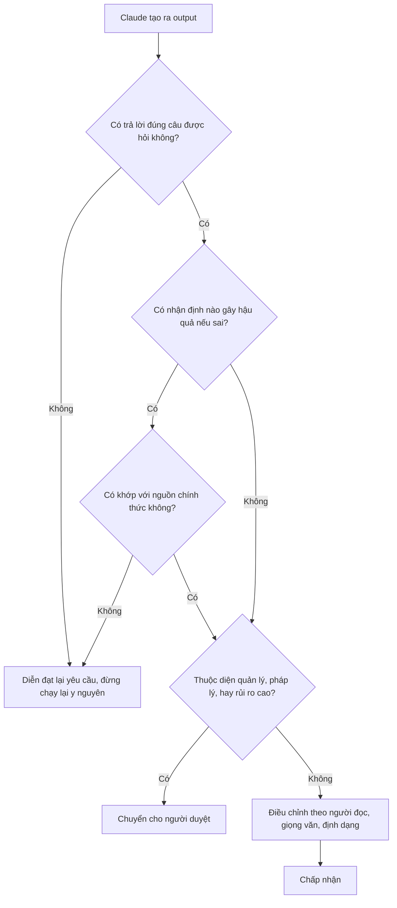

# Ghi chú ôn thi: Associate – Foundations

Ghi chú làm việc của tác giả khi ôn kỳ thi này, sắp xếp theo domain trong blueprint. Chúng cô đọng những điều quan trọng, không thay thế exam guide, và không có gì ở đây lấy từ đề thật (vốn được bảo vệ bởi thoả thuận không tiết lộ).

Cách dùng: đọc trang Tổng quan của chứng chỉ trước để nắm số liệu và blueprint, rồi đi qua trang này theo từng domain, kiểm tra xem dòng nào bạn cũng thấy hiển nhiên. Dòng nào chưa thấy hiển nhiên là mục tiêu cần ôn.

## Domain 2 trước tiên: đánh giá output (21%)

**Domain lớn nhất của đề này là kiểm tra, không phải tạo ra.** Đề kiểm tra xem bạn có phân biệt được câu trả lời sai với câu trả lời đúng không, đó là kỹ năng khác với việc có được câu trả lời.

Chạy lại là phản xạ thường gặp nhưng hiếm khi là cách sửa. Nếu output sai vì yêu cầu mơ hồ, lần thử thứ hai chỉ là một lần đoán thứ hai.

Domain lớn nhất nên được xếp đầu. Tư duy đề thưởng điểm là sự hoài nghi chuyên nghiệp, áp dụng một cách tiết kiệm:

- Coi mọi chi tiết trông cụ thể trong output (số trích dẫn, thống kê, tên, ngày tháng) là chưa kiểm chứng cho tới khi đối chiếu với nguồn có thẩm quyền. Giọng tự tin và mức tự tin model tự báo không phải tín hiệu chính xác.
- Biết các kiểu hỏng phổ biến: chi tiết bịa đặt, bản tóm tắt nghe hợp lý nhưng sai, bỏ sót âm thầm, và thiên lệch thừa hưởng từ cách đặt vấn đề.
- Quy trình kiểm chứng đáng thấm: xác định những nhận định gây hậu quả nếu sai, kiểm chúng với nguồn chính thức, và chuyển mọi thứ thuộc diện quản lý, pháp lý hay rủi ro cao cho người duyệt.
- Điều chỉnh output theo người đọc (giọng văn, định dạng, độ dài, artifact hay nội dung trong chat) là nội dung được chấm điểm, không phải chuyện phụ.

## Prompting và thực hiện tác vụ (14%)

- Cấu trúc thắng sự khéo léo: nêu vai trò, tác vụ, bối cảnh, ràng buộc và định dạng output. Chia yêu cầu lớn thành các bước thay vì một prompt lan man.
- Lặp lại là phương pháp: xem output sai chỗ nào, đổi một thứ, chạy lại. Các loại tác vụ khác nhau (phân tích, nghiên cứu, soạn thảo, brainstorm) cần chiến lược khác nhau, và đề mong bạn ghép đúng.

## Chọn sản phẩm và model (12%)

Bảng đánh đổi cần thuộc lòng:

| Model | Đặc điểm | Phù hợp với |
| --- | --- | --- |
| Haiku | Nhanh nhất, rẻ nhất | Việc khối lượng lớn, đơn giản |
| Sonnet | Cân bằng | Phần lớn công việc hằng ngày |
| Opus | Mạnh nhất, đắt nhất và chậm nhất | Suy luận phức tạp đáng với chi phí |

- Chọn tính năng cũng được kiểm tra theo cách tương tự: Project cho context lặp lại, research mode cho câu trả lời có nguồn, Artifact cho tài liệu và sản phẩm có cấu trúc, chat thường cho việc nhanh.
- Context có giới hạn. Biết khi nào bắt đầu cuộc hội thoại mới, khi nào tóm tắt và mang theo, và khi nào lưu knowledge trong Project thay vì dán lại.

## Tích hợp workflow và thiết kế giải pháp (16%)

- Kỹ năng được đánh giá cao là biến một vấn đề kinh doanh thành workflow dùng Claude: phân tích yêu cầu, chọn chỗ Claude tạo giá trị, tích hợp vào quy trình đang có thay vì đắp bên ngoài, và nói được giá trị cùng giới hạn của nó với stakeholder một cách rõ ràng.
- Thiết kế lại thắng gắn thêm: chính exam guide dùng cụm "tái hình dung quy trình", không chỉ tự động hoá từng tác vụ.

## Cấu hình và quản lý knowledge (12%)

- Project: chỉ dẫn định nghĩa hành vi, nguồn knowledge định nghĩa những gì nó biết. Giữ chỉ dẫn ngắn, cụ thể và được duy trì; knowledge cũ là lỗi chất lượng do bạn chịu trách nhiệm.
- Connector (Google Drive, Gmail) mở rộng phạm vi; quản lý những gì được kết nối là một phần của quản trị, không chỉ là tiện lợi.

## Quản trị, rủi ro và sử dụng có trách nhiệm (15%)

- Mẫu mà câu hỏi mẫu thưởng điểm: làm cho tác vụ an toàn, rồi mới làm. Ẩn danh hoặc che các định danh bị quản lý trước khi tải lên, thay vì bỏ tác vụ hoặc tin vào một lời dặn model để bù đắp.
- Biết các loại dữ liệu của tổ chức bạn và loại nào không bao giờ được rời hệ thống đã phê duyệt. "Dặn Claude đừng lưu lại" không phải biện pháp kiểm soát.
- Phán đoán về sử dụng đúng mục đích được kiểm tra: một số tác vụ không phù hợp với AI trong bối cảnh của bạn, bất kể năng lực.

## Xử lý sự cố và tối ưu (10%)

- Chẩn đoán trước khi viết lại: lỗi do thiếu context, chỉ dẫn mơ hồ, sai tính năng hay sai model? Sửa đúng nguyên nhân đã xác định, không sửa mọi thứ cùng lúc.
- Tối ưu nghĩa là rẻ hơn và nhanh hơn với cùng chất lượng: prompt dùng lại được, Project cho context lặp lại, và model nhỏ nhất giữ được chất lượng.

## Danh sách cần nhớ

Những dữ kiện nên nhớ ngay trong ngày thi: 60 câu, 120 phút, đậu 720/1.000, không được xem tài liệu, có kết quả ngay trên màn hình, huy hiệu qua Credly, chứng chỉ hiệu lực 12 tháng và gia hạn bằng bài đánh giá miễn phí, thi lại phải chờ lần lượt 14, 30, rồi 90 ngày, và chứng chỉ Associate không được tính vào điều kiện hạng đối tác.
