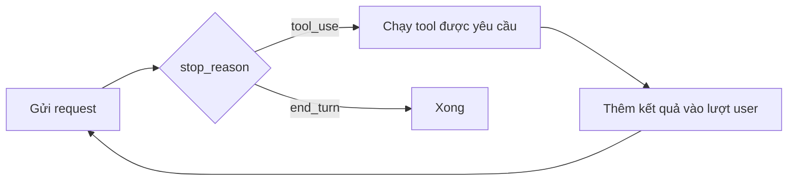
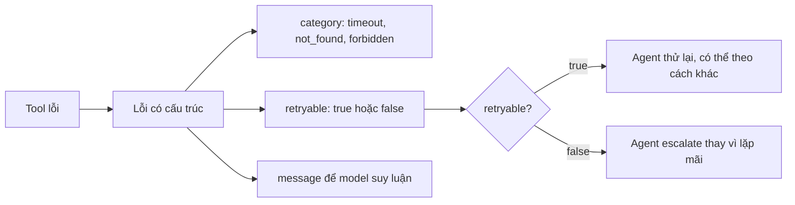

# Ghi chú ôn thi: Architect – Foundations

Ghi chú làm việc của tác giả khi ôn kỳ thi này. Đây là đề mà việc chuẩn bị được đền đáp trực tiếp nhất, vì sáu tình huống được công bố trước và phụ lục của exam guide nêu tên các công nghệ có thể được hỏi. Không có gì ở đây lấy từ đề thật (vốn được bảo vệ bởi thoả thuận không tiết lộ); mọi thứ đều truy được về exam guide.

## Học theo tình huống, không chỉ theo domain

Mỗi lần thi có 4 trong 6 tình huống đã công bố. Với từng tình huống, tác giả ghi ra những gì nó buộc phải hỏi, rồi học đúng phần giao nhau đó. Bản rút gọn:

| Tình huống | Buộc bạn phải biết |
| --- | --- |
| Agent giải quyết ticket hỗ trợ | Thiết kế vòng lặp agent, ranh giới tool MCP (get_customer, process_refund), khi nào escalate và khi nào tự giải quyết, least privilege cho các tool kiểu hoàn tiền |
| Claude Code cho lập trình | Phân cấp CLAUDE.md, slash command, plan mode hay làm ngay, tinh chỉnh lặp lại |
| Nghiên cứu đa agent | Điều phối coordinator và subagent, truyền context, giữ nguồn gốc và trích dẫn, lan truyền lỗi |
| Công cụ năng suất cho lập trình viên | Chọn built-in tool (Read, Write, Bash, Grep, Glob), tích hợp MCP server, quản lý context ở quy mô codebase |
| Claude Code trong CI/CD | Chế độ headless (-p, --output-format json, --json-schema), prompt review có tiêu chí rõ, kiểm soát báo sai, review nhiều lượt |
| Trích xuất dữ liệu có cấu trúc | tool_use với JSON schema, vòng validate-retry, trường optional và nullable, xử lý theo lô |

## Vòng lặp agent, chính xác từng bước

Những chi tiết phân biệt đáp án đúng: kết quả tool được đưa lại vào lịch sử hội thoại để model suy luận trên đó; dừng vòng lặp cần một điều kiện rõ ràng chứ không chỉ trông chờ end_turn; hook (ví dụ PostToolUse) chặn lời gọi tool để kiểm tra, ghi log hoặc ngăn chặn; subagent được tạo ra để giao việc và cô lập context, với allowedTools giới hạn những gì mỗi subagent được chạm tới.

## Quy tắc kinh nghiệm khi thiết kế tool MCP

- Mô tả tool là hợp đồng giao diện; viết sao cho model chọn đúng giữa các tool giống nhau ngay lần đầu.
- Lỗi là dữ liệu: trả về lỗi có cấu trúc gồm loại lỗi và cờ retryable, dùng cờ isError thay vì giấu lỗi trong văn xuôi. Model chỉ phục hồi được từ lỗi nó hiểu được.
- Phân tool theo vai trò: agent soạn trả lời không cần process_refund. Gỡ hẳn năng lực tốt hơn canh chừng nó.
- Cấu hình nằm trong .mcp.json, kể cả mở rộng biến môi trường cho thông tin bí mật.

## Cấu hình Claude Code, phần có thể bị hỏi

- Phân cấp CLAUDE.md: cấp user, cấp project, cấp thư mục; cái cụ thể hơn thắng. Quy ước theo đường dẫn đặt trong .claude/rules/ với YAML frontmatter, chỉ nạp khi đụng tới file khớp.
- Custom command trong .claude/commands/; Skills trong .claude/skills/ với frontmatter SKILL.md, trong đó context: fork, allowed-tools và argument-hint là các tuỳ chọn được exam guide nêu tên.
- Plan mode cho việc bạn muốn được duyệt trước khi làm, làm ngay cho thay đổi đã hiểu rõ. /compact quản lý phiên dài, --resume và fork_session quản lý trạng thái phiên.
- Dùng trong CI là không tương tác: -p hoặc --print, --output-format json, và --json-schema để ép output review máy đọc được.

## Mẫu output có cấu trúc

- Ép hình dạng bằng tool_use cộng JSON schema thay vì nhờ khéo "trả JSON nhé". tool_choice có thể ép phải gọi tool.
- Thiết kế schema là việc phán đoán: trường bắt buộc cho thứ phải có, nullable hoặc optional cho thứ có thể không có, enum cộng một giá trị "other" kèm chuỗi chi tiết cho tập mở.
- Vòng tin cậy: validate (Pydantic hoặc tương đương), đưa lỗi validation trở lại, retry; đo tỷ lệ lỗi bằng mẫu có nhãn thay vì tin vào kiểm tra lẻ tẻ; gắn độ tin cậy và chuyển trích xuất có độ tin cậy thấp cho người duyệt.
- Việc khối lượng lớn đi qua Message Batches API: nửa giá, cửa sổ 24 giờ, khớp bằng custom_id, và không gọi tool nhiều lượt bên trong một batch.

## Context và độ tin cậy

**Tool lỗi thì nên trả về gì.** Hình dạng của lỗi quyết định agent có làm được gì hữu ích với nó hay không.

Một stack trace không cho agent biết phải làm gì. Loại lỗi và cờ retryable cho phép nó quyết định, và đó là khác biệt giữa một vòng lặp tự phục hồi với một vòng lặp quay vô tận.

- Tác vụ dài: rút dữ kiện có cấu trúc từ output tool dài dòng ngay khi làm, giữ một file scratchpad cho trạng thái lâu dài, và giao việc con cho subagent để context chính sạch sẽ. Cẩn thận hiệu ứng lost-in-the-middle: dữ kiện quan trọng nên nằm ở đầu hoặc cuối cửa sổ.
- Escalation là quyết định thiết kế làm từ trước: ngoài chính sách, khách yêu cầu rõ ràng, và không tiến triển được là các trigger escalate; mọi thứ khác tự giải quyết kèm ghi log.
- Trong hệ đa agent, lỗi phải được truyền lên kèm đủ context để coordinator chọn thử lại, đổi hướng hay dừng; nguồn gốc thông tin (nguồn nào nói gì) chỉ sống qua các lần chuyển giao nếu bạn thiết kế cho nó.

## Danh sách cần nhớ

60 câu thuộc 4 trong 6 tình huống đã công bố, 120 phút, đậu 720/1.000, giá niêm yết 125 USD (99 USD trước 30/6/2026), được tính vào hạng đối tác, các lần trượt trước khi chuyển đổi đã được xoá, chứng chỉ hiệu lực 12 tháng và gia hạn miễn phí.
