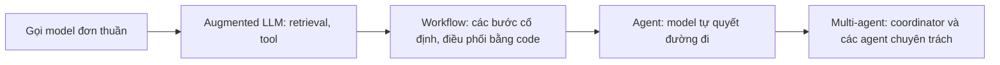
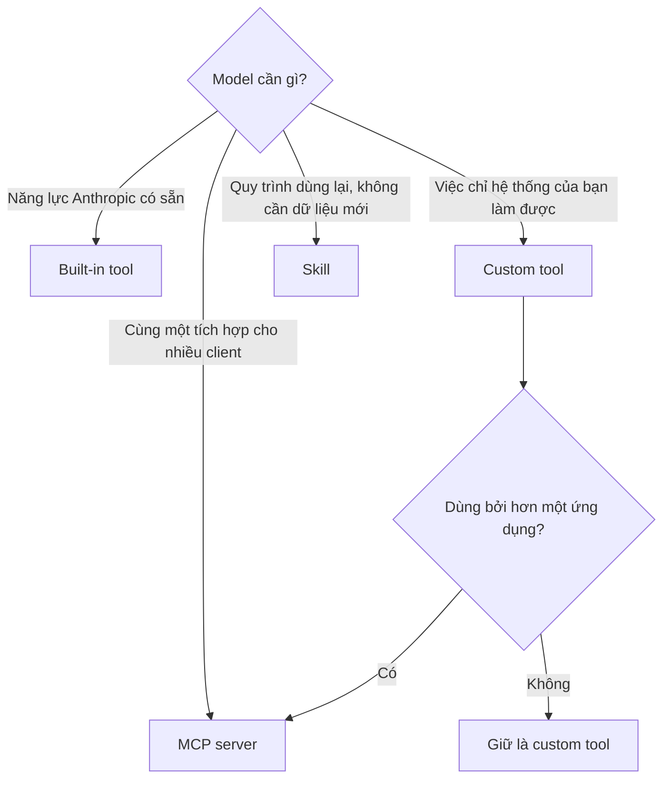

# Ghi chú ôn thi: Architect – Professional

Ghi chú làm việc của tác giả khi ôn kỳ thi này. Đây là đề rộng nhất trong bốn đề: ít xoáy vào cơ chế của một API cụ thể, nhiều hơn về thiết kế đầu-cuối bảo vệ được. Không có gì ở đây lấy từ đề thật (vốn được bảo vệ bởi thoả thuận không tiết lộ); mọi thứ đều truy được về exam guide.

## Bậc thang mẫu kiến trúc

Phần lớn câu thiết kế quy về việc chọn cấu trúc rẻ nhất mà vẫn tin cậy:

Chỉ dịch sang phải khi bậc bên trái chứng minh được là không đáp ứng yêu cầu. Đáp án nào thêm agent, năng lực hay kích thước model mà không có nhu cầu được nêu thường là đáp án sai; phần giải thích mẫu luôn thưởng cho việc bỏ đi thứ không cần thiết.

## Integration (19%), domain nặng nhất

**Chọn thứ để xây.** Domain nặng nhất của đề, và quyết định nó liên tục kiểm tra là cơ chế nào phù hợp, chứ không phải nối dây thế nào.

Phình năng lực là kiểu hỏng ở phía bên kia: mỗi tool bạn thêm vào làm mọi tool khác khó được chọn đúng hơn một chút.

- **Least privilege là phản xạ**: gỡ hẳn tool và quyền mà vai trò không cần. Log và hộp xác nhận là biện pháp bù trừ, không thay thế được việc gỡ bỏ.
- **Thiết kế RAG**: chunking nên theo cấu trúc tài liệu, cách đánh chỉ mục và truy xuất phải khớp hình dạng dữ liệu và kiểu truy vấn, và hybrid retrieval tồn tại là có lý do. Lỗi kinh điển: trả lời tự tin nhưng sai sau khi làm mới tài liệu là chỉ vào truy xuất và index, không phải model.
- **Chọn giao thức**: MCP cho năng lực hướng model dùng lại được; API hoặc CLI trực tiếp cho pipeline cố định; agent-to-agent khi các hệ tự hành phải phối hợp với nhau. Khi bề mặt tool lớn, nạp tool dần (progressive discovery) tốt hơn nạp một context khổng lồ.
- **Observability ở quy mô lớn** phải được thiết kế từ đầu: trace lời gọi tool và các quyết định, không chỉ output cuối, nếu không thì không khoanh được lỗi production về đúng tầng.

## Evaluation (16%)

- Chỉ số trải từ độ chính xác, độ trễ, chi phí tới an toàn và bảo mật; chọn theo từng use case và đặt ra trước khi xây.
- Bộ dữ liệu đánh giá cần phủ ca biên và kết hợp phương pháp: kiểm chính xác khi sự thật rõ ràng, rubric hoặc model chấm khi không rõ, người duyệt khi mức rủi ro đòi hỏi.
- A/B test biện minh cho thay đổi; regression suite giữ cho các cập nhật model hay prompt trung thực. Thứ tự chẩn đoán khi xuống cấp: dữ liệu và truy xuất trước, rồi prompt, rồi đến model không phù hợp.

## Model, prompting và context (13%)

- Chọn model là đánh đổi chi phí – độ trễ – chất lượng, lập luận từ tác vụ, không phải từ sở thích thương hiệu.
- Đáp án về caching dùng được ở nhiều nơi: nội dung tĩnh trước, động sau, cache phần tiền tố; giảm cả độ trễ lẫn chi phí, và xuất hiện trong câu hỏi mẫu chính thức.
- Dùng lại prompt ở quy mô doanh nghiệp nghĩa là prompt dạng module, có phiên bản, và Skills, để thay đổi hành vi là sự kiện được review chứ không phải trôi dạt âm thầm.

## Governance và an toàn (14%)

- Guardrail phải nhiều lớp: kiểm tra đầu vào, lọc đầu ra, giới hạn quyền, người duyệt cho hành động có hệ quả. Một lớp là một điểm hỏng duy nhất.
- Đặt người duyệt ở nơi lỗi tốn kém hoặc không đảo ngược được; định tuyến theo độ tin cậy giúp chi phí chấp nhận được.
- Ánh xạ quy định, mỗi cái một dòng: GDPR điều chỉnh dữ liệu cá nhân của người ở EU (tối thiểu hoá, mục đích, xoá), HIPAA điều chỉnh thông tin sức khoẻ ở Mỹ, FedRAMP điều chỉnh triển khai cloud cho liên bang Mỹ. Biết quy định nào áp dụng cho tình huống và nó buộc thiết kế phải thế nào.
- Đạo đức được chấm điểm rất cụ thể: kiểm tra thiên lệch, công bằng giữa các nhóm người dùng, minh bạch về việc có AI tham gia.

## Stakeholder và vòng đời (14%), domain bị đánh giá thấp

- Khảo sát có cấu trúc trước khi thiết kế: vấn đề kinh doanh, ràng buộc, thước đo thành công, rồi mới tới kiến trúc.
- Quyết định được ghi lại kèm đánh đổi (ADR là hình thức tự nhiên), kỳ vọng được quản lý bằng SLA rõ ràng, và bàn giao gồm hướng dẫn triển khai chứ không chỉ sơ đồ.
- Tư duy vòng đời kéo dài sau triển khai: giám sát, vòng phản hồi và cải tiến là một phần của thiết kế, và đề coi việc giao tiếp về tất cả những điều này là một kỹ năng kỹ thuật.

## Năng suất lập trình viên (7%)

- Công cụ Claude ở cấp đội: cấu hình Claude Code dùng chung, prompt và Skills chuẩn hoá, quy trình debug có AI hỗ trợ. Domain nhỏ; đừng đầu tư quá nhiều.

## Danh sách cần nhớ

63 câu, 120 phút, đậu 720/1.000, giá niêm yết 175 USD, được tính vào hạng đối tác, không có điều kiện tiên quyết (Architect Foundations chỉ là thứ tự khuyến nghị), chứng chỉ hiệu lực 12 tháng và gia hạn miễn phí, thi lại phải chờ lần lượt 14, 30, rồi 90 ngày.
