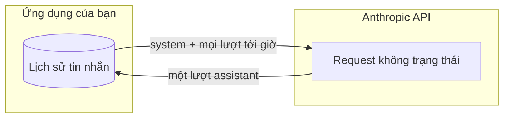
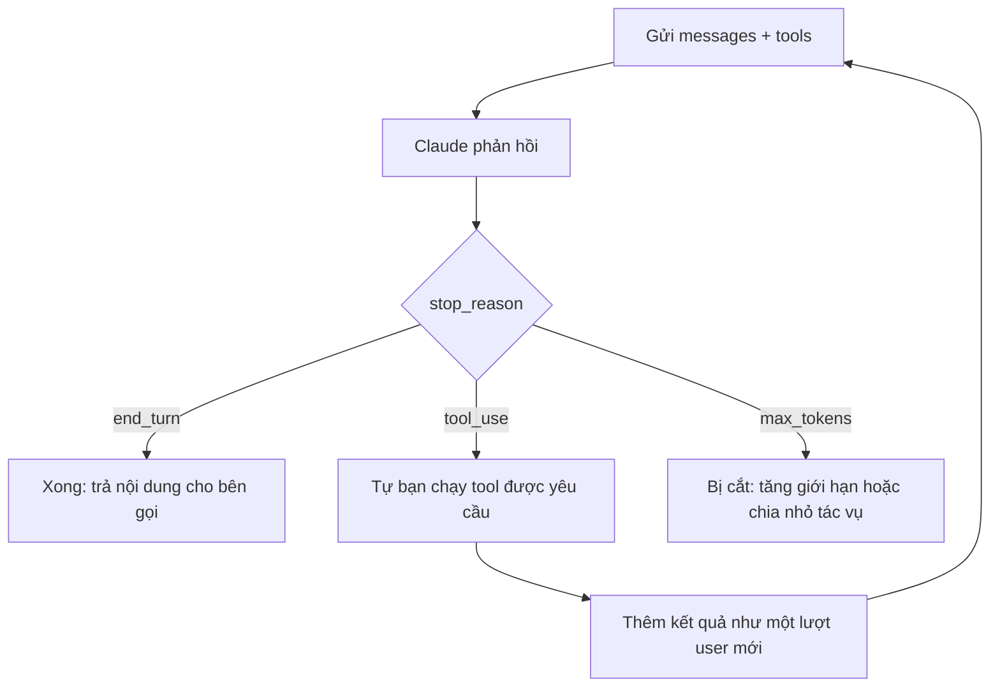
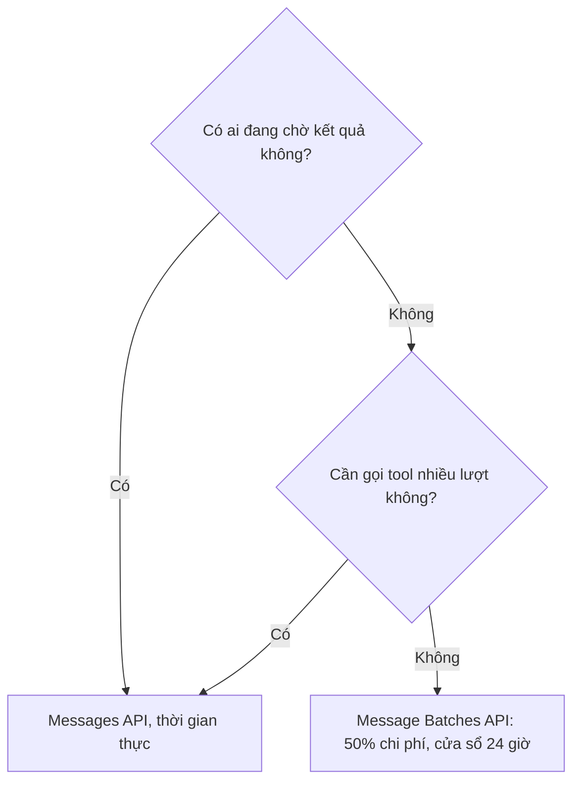
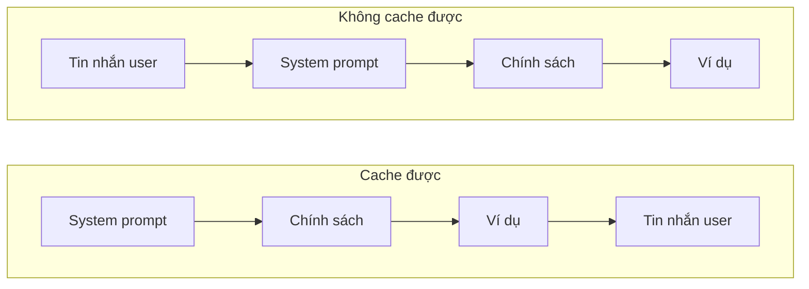

# Ghi chú ôn thi: Developer – Foundations

Ghi chú làm việc của tác giả khi ôn kỳ thi này, sắp xếp theo những gì tỷ trọng kỹ năng công bố cho thấy là đáng chú ý. Chúng cô đọng những điều quan trọng, không thay thế exam guide, và không có gì ở đây lấy từ đề thật (vốn được bảo vệ bởi thoả thuận không tiết lộ).

Phép tính tỷ trọng nên quyết định cách bạn chia thời gian: Applications and Integration (33,1%) cộng Model Selection and Optimization (16,8%) cộng Agents and Workflows (14,7%) là gần hai phần ba đề. Claude Code (3,1%) và Eval, Testing, and Debugging (2,6%) cộng lại chỉ khoảng ba câu.

## Cơ chế API (phần lõi cộng mọi thứ nó chạm tới)

- **Messages API**: trạng thái hội thoại nằm ở phía client; bạn gửi toàn bộ lịch sử tin nhắn mỗi lần gọi. System prompt đặt hành vi lâu dài; lượt user và assistant mang nội dung hội thoại.

**Hội thoại nằm ở đâu.** Server không giữ phiên nào cả. Bạn giữ lịch sử và gửi lại, vì vậy hội thoại dài tốn hơn mỗi lượt so với hội thoại ngắn.

- **stop_reason** là tín hiệu điều khiển: `end_turn` nghĩa là xong, `tool_use` nghĩa là chạy tool được yêu cầu rồi trả kết quả trong một lượt user mới. Vòng lặp agent chính xác là chu trình này.

**Vòng lặp tool.** Chu trình này là toàn bộ hành vi agent trên API. `stop_reason` điều khiển nó, và agent là vòng lặp này lặp lại cho tới `end_turn`.

Hai điều sơ đồ cho thấy rõ mà lời văn không: **bạn** chạy tool, không phải Claude. Và kết quả quay lại dưới dạng lượt **user**, vì vậy lịch sử dài thêm sau mỗi vòng.

- **Streaming** giảm độ trễ cảm nhận, không giảm chi phí. **Vision** và đầu vào nhiều định dạng đi vào dưới dạng content block.
- **Message Batches API**: cho việc khối lượng lớn chịu được trễ. 50% chi phí, kết quả trong cửa sổ 24 giờ, khớp bằng custom_id, không gọi tool nhiều lượt. Đánh đổi batch hay thời gian thực là dạng tình huống được ưa chuộng: qua đêm và cần tiết kiệm nghĩa là batch.

**Batch hay thời gian thực.** Dạng tình huống này lặp lại nhiều, và nó xoay quanh một câu hỏi chứ không phải chi phí.

Chi phí là hệ quả, không phải tiêu chí. Hỏi "ai đang chờ" trước.

- **Prompt caching**: đặt nội dung ổn định (system prompt, chính sách, ví dụ) lên trước, nội dung thay đổi để sau, để phần tiền tố dùng lại được. Caching giảm cả độ trễ lẫn chi phí; sắp xếp lại prompt thường là toàn bộ cách sửa.

**Vì sao thứ tự quyết định mức tiết kiệm.** Cache khớp theo tiền tố. Bất cứ thứ gì thay đổi đặt ở đầu sẽ phá vỡ việc khớp cho mọi thứ sau nó, nên cùng nội dung mà sai thứ tự thì không cache được gì.

Ở cách sắp xếp thứ hai, tiền tố thay đổi mỗi request, nên không gì phía sau dùng lại được. Sắp xếp lại thường là toàn bộ việc tối ưu.

## Chọn model và chi phí (16,8%)

- Haiku cho việc đơn giản khối lượng lớn, Sonnet làm mặc định, Opus khi chiều sâu suy luận đáng đồng tiền. Extended/adaptive thinking và mức effort đổi độ trễ lấy chất lượng ở bài khó.
- Token là đơn vị của mọi thứ: lập ngân sách, theo dõi mức dùng, và nhớ rằng context window giới hạn cả hội thoại lẫn câu trả lời.
- Phiên bản model mới có thể thay đổi hành vi. Ghim phiên bản model trên production và coi nâng cấp là thay đổi cần đánh giá, không phải thay thế cắm là chạy.

## Agent và workflow (14,7%)

- **Workflow hay agent**: nếu các bước biết trước, điều phối bằng workflow; dành vòng lặp agent tự hành cho tác vụ mà model phải quyết định đường đi. Cấu trúc rẻ nhất mà tin cậy sẽ thắng.
- Mô hình manager/supervisor giao việc cho subagent; subagent còn cô lập context để một cuộc điều tra dài không làm bẩn luồng chính.
- Hook cho kiểm soát tất định tại ranh giới vòng lặp, đó là cách thực thi guardrail mà không thể tin LLM tự giữ.
- Biết Claude Agent SDK cho bạn gì so với tự viết vòng lặp, so với các framework như LangGraph, Strands, PydanticAI: đánh đổi là quyền kiểm soát so với quy ước có sẵn.

## Tool, Skill và MCP (10,6%)

Bảng quyết định mà tác giả quay lại nhiều nhất:

| Nhu cầu | Dùng |
| --- | --- |
| Năng lực bên trong một ứng dụng | Custom tool có schema rõ ràng |
| Năng lực dùng lại giữa nhiều ứng dụng, duy trì độc lập | MCP server |
| Chỉ dẫn và quy ước dùng lại, không phải code | Skill |
| File, shell và tìm kiếm cơ bản | Built-in tool |

- Mô tả tool chính là prompt: model chọn tool bằng cách đọc chúng, nên các tool giống nhau cần mô tả phân biệt rõ.
- Thực thi phía client hay phía server, và mẫu phê duyệt cho thao tác nguy hiểm, nằm trong phạm vi thi.

## Prompt, context và output (11,0% + 2,6%)

- System prompt cho hành vi lâu dài, lượt user cho tác vụ. Few-shot sửa định dạng và ca biên tốt hơn thêm chỉ dẫn.
- Context trôi và phình được quản lý bằng cách tỉa output tool, nén lịch sử, và cô lập việc con trong subagent.
- Coi output của model là đầu vào không tin cậy cho hệ thống của bạn: validate output có cấu trúc theo schema, parse phòng thủ, và retry kèm lỗi validation.

## Bảo mật (8,1%)

Đáp án mẫu của đề cho prompt injection, đáng thuộc như một khuôn: coi nội dung truy xuất hoặc do người dùng cung cấp là dữ liệu không tin cậy, tách nó khỏi chỉ dẫn tin cậy, và thực thi least privilege bằng guardrail hoặc hook để văn bản bị chèn không kích hoạt được hành động nhạy cảm. Model lớn hơn, temperature cao hơn, hay lời nhờ lịch sự trong system prompt đều là đáp án sai. Thông tin bí mật nằm trong kho quản lý chuyên dụng, không bao giờ trong prompt hay code; PII được tối thiểu hoá trước khi tới model.

## Danh sách cần nhớ

53 câu, 120 phút, đậu 720/1.000, không được xem tài liệu, giá niêm yết 125 USD, được tính vào điều kiện hạng đối tác, chứng chỉ hiệu lực 12 tháng và gia hạn miễn phí, thi lại phải chờ lần lượt 14, 30, rồi 90 ngày.
